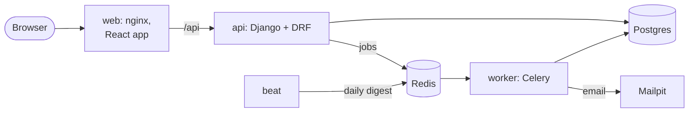

# Task Manager

Create tasks, assign them to people, mark them done, and filter by status and due date.
A Django 6.1 + DRF API on PostgreSQL, Celery + Redis for email in the background, and a React +
TypeScript frontend, all started with one `docker compose` command. Built as a technical
interview exercise; [HANDOFF.md](HANDOFF.md) is the brief it follows.

## Quick start

Needs Docker (with Compose v2).

```sh
git clone https://github.com/lmedhub/python-bla.git
cd python-bla
cp .env.example .env
docker compose up --build
```

The first build takes a few minutes. When every service is healthy:

| What | Where |
| --- | --- |
| The app | http://localhost:8080 |
| API docs (Swagger UI) | http://localhost:8080/api/v1/docs (ReDoc: `/api/v1/redoc`) |
| Emails the app sends (Mailpit) | http://localhost:8025 |

### Demo users

The database is seeded on first start (only when it is empty):

| Email | Password |
| --- | --- |
| `alice@example.com` | `demo-password-2026` |
| `bob@example.com` | `demo-password-2026` |
| `carol@example.com` | `demo-password-2026` |
| `dana@example.com` | `demo-password-2026` |

30 tasks cover every status, overdue tasks, tasks due today, unassigned tasks and tasks without a
due date. Sign in as two people in two browsers to see the permission rules: the creator may
change anything, the assignee only the status, everyone else may only read.

To try Swagger UI: `POST /auth/login` with a demo user, copy `access`, click **Authorize**, paste it.

To start over with fresh demo data: `docker compose down --volumes`, then `up` again
(`make fresh` on Linux/macOS).

Safari does not accept the `Secure` refresh cookie on `http://localhost`. Use another browser,
or set `REFRESH_COOKIE_SECURE=false` in `.env` for the demo.

## What it does

- **Tasks**: create, read, update, delete. Title (1–200 characters), description, status
  (`todo`, `in_progress`, `done`), due date, assignee. Completing sets `completed_at` once.
- **Rules**: everyone signed in can read every task; the creator may change and delete it; the
  assignee may change its status only. A due date may not be in the past when the task is
  created. "Today" and "overdue" use the caller's time zone (sent as `X-Timezone`).
- **List**: filter by status, assignee (or "me"), due date range and overdue; ordered by due
  date; paginated. Filters and page live in the URL.
- **Auth**: JWT. A short-lived access token kept in memory by the frontend, and a rotating
  refresh token in an HttpOnly cookie, blacklisted on use and on sign out.
- **Rate limits**: 20 requests a minute anonymous, 100 signed in, 5 login attempts per IP.
- **Background jobs**: an email when a task is assigned, and a daily digest of overdue tasks
  (`OVERDUE_DIGEST_CRON`). If Redis is down, requests still succeed and the lost email is logged.
- **Conflicts**: edits carry the version the client read; a stale edit is a 409, never a silent
  overwrite.

## Architecture



The backend is split by feature (`tasks`, `users`), each in four layers: `domain` (plain Python
rules), `application` (use cases and ports), `infrastructure` (Django ORM, Celery, mail) and
`interfaces` (DRF views, Celery jobs, wiring). import-linter enforces the direction of imports in
pre-commit and CI. Diagrams and a request walkthrough are in
[docs/architecture.md](docs/architecture.md).

## Decisions

Each non-obvious choice has a short record in [docs/adr/](docs/adr/):

| ADR | Decision |
| --- | --- |
| [0001](docs/adr/0001-feature-first-clean-architecture.md) | Feature-first Clean Architecture, enforced by import-linter and ruff |
| [0002](docs/adr/0002-drf-spectacular-over-drf-yasg.md) | drf-spectacular for OpenAPI 3 |
| [0003](docs/adr/0003-jwt-session-design.md) | JWT: access token in memory, refresh token in an HttpOnly cookie |
| [0004](docs/adr/0004-celery-builtin-beat.md) | Celery's built-in beat, schedule from an environment variable |
| [0005](docs/adr/0005-degrade-when-redis-is-down.md) | Degrade, don't fail, when Redis is down (measured) |
| [0006](docs/adr/0006-drop-django-filter.md) | List filters validated by a serializer instead of django-filter |
| [0007](docs/adr/0007-due-date-rule.md) | Due date rule, and "today" in the caller's time zone |
| [0008](docs/adr/0008-domain-errors.md) | Shared domain errors, one HTTP status each |
| [0009](docs/adr/0009-user-model-and-cross-feature-lookup.md) | Custom user model, lowercase emails, cross-feature lookups |
| [0010](docs/adr/0010-optimistic-locking.md) | Optimistic locking with a version column |
| [0011](docs/adr/0011-api-conventions.md) | API conventions (error shape, pagination, permissions) |
| [0012](docs/adr/0012-background-notifications.md) | At-least-once email with a sent log |
| [0013](docs/adr/0013-frontend-architecture.md) | Frontend architecture |
| [0014](docs/adr/0014-running-the-stack-and-demo-data.md) | nginx in front, demo data on an empty database |
| [0015](docs/adr/0015-list-indexes.md) | Indexes for the task list, measured with EXPLAIN ([evidence](docs/explain.md)) |

Decisions taken during the work, and every deviation from the brief, are listed in
[PLAN.md](PLAN.md).

## Development

### Backend

Needs [uv](https://docs.astral.sh/uv/) and Docker (for Postgres and Redis).

```sh
cp .env.example .env
docker compose up -d db redis mailpit
cd backend
uv sync
uv run --env-file ../.env python manage.py migrate
uv run --env-file ../.env python manage.py runserver      # http://localhost:8000
```

Celery outside Docker (from `backend/`). On Windows the worker needs `--pool solo`, because
Celery's default pool does not run on Windows:

```sh
uv run --env-file ../.env celery -A config.celery worker --loglevel info --pool solo
uv run --env-file ../.env celery -A config.celery beat --loglevel info
```

Pre-commit hooks: `uv run --directory backend pre-commit install`.

### Frontend

Needs Node 22.22 or later. `frontend/.npmrc` pins the public npm registry, whatever your
user-level npm configuration says.

```sh
cd frontend
npm ci
npm run dev        # http://localhost:5173, proxies /api to runserver on :8000
```

### The API contract

[openapi.yaml](openapi.yaml) is generated from the serializers and committed; the frontend's
TypeScript types are generated from it. `make schema` regenerates both. CI fails if either is out
of date.

## Tests and checks

Postgres and Redis must be running for the backend tests (`docker compose up -d db redis`).

Linux / macOS:

```sh
make lint    # backend: ruff, ruff format, mypy --strict, import-linter, missing migrations;
             # frontend: eslint, tsc
make test    # pytest with a 90% coverage gate, then vitest
```

`make lint-backend`, `make test-frontend` and so on run one side only.

Windows (the same commands, without make):

```sh
cd backend
uv run ruff check . ; uv run ruff format --check . ; uv run mypy . ; uv run lint-imports --no-cache
uv run python manage.py makemigrations --check --dry-run --settings=config.settings.test
uv run pytest
cd ../frontend
npm run lint ; npm run typecheck ; npm test
```

On Windows, run the frontend commands from a path with an upper-case drive letter (`C:\...`).
Some editors start shells in `c:\...`, and Vitest then loads its own modules twice and fails with
"Vitest failed to find the runner".

What the tests cover:

- **Backend** (pytest, 351 tests, ~99.8% coverage): domain rules with no Django; use cases with
  in-memory fakes; repositories against real Postgres; the API's status codes, permissions,
  validation, pagination, filters, rate limits and query counts; Celery jobs and the
  Redis-down path against a real broker.
- **Frontend** (Vitest + Testing Library + MSW, 67 tests): session and refresh logic, sign in,
  list, filters in the URL, forms, conflicts, delete. A test fails on any console warning.
- **Whole stack**: CI starts everything from a clean checkout and runs
  [scripts/smoke_test.py](scripts/smoke_test.py) through nginx.

## Known limits and next steps

- **Lost emails while Redis is down.** The task is saved, the email is not sent, and a log line
  says so. Next step: a transactional outbox (ADR 0012).
- **A rare duplicate email** if a worker crashes between sending and recording (ADR 0012).
- **Slower requests while Redis is down**: about 1 s for each Redis call, bounded by timeouts
  (ADR 0005).
- **The digest uses UTC** for "today", because a scheduled job has no caller time zone.
- **`GET /users` is not paginated**: fine for a team, not for a large organisation.
- **Delete is not version-checked**, so a delete can win over a concurrent edit (ADR 0010).
- **Validation reports one business rule at a time** (title, then due date, then assignee).
- **`SentNotification` keeps growing**; a cleanup job is a next step.
- **Celery beat has no healthcheck.**
- **Docker's scanner** reports 2 high-severity issues in the Python base image (Phase 7 review).
- More detail, including test-only limits, in [PLAN.md](PLAN.md#known-limits-so-far).

## Docs

- [HANDOFF.md](HANDOFF.md): the brief, scope and rules
- [PLAN.md](PLAN.md): phases, decisions and deviations
- [docs/architecture.md](docs/architecture.md): diagrams and a request walkthrough
- [docs/adr/](docs/adr/): architecture decision records
- [docs/GENAI.md](docs/GENAI.md): how AI was used, how its output was checked, and its mistakes
