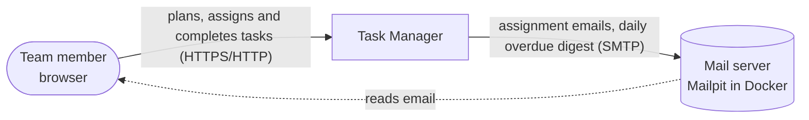
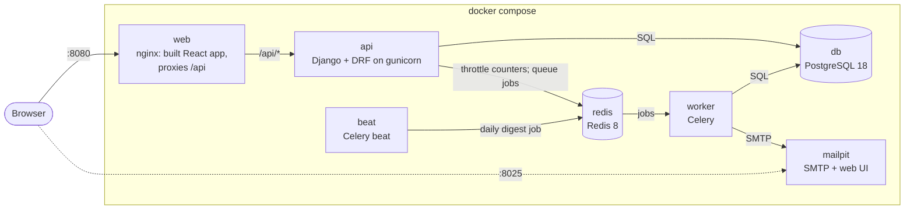
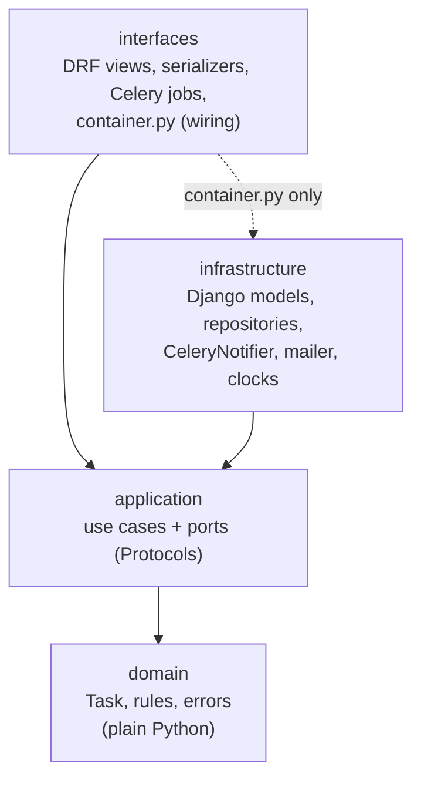
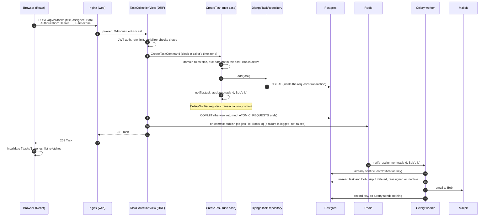

# Architecture

How the pieces fit, from the outside in. The decisions behind each part are in
[docs/adr/](adr/).

## System context

## Containers (docker compose)

- **web**: the only entry point to the app and the API (ADR 0014). db, redis and mailpit also
  publish ports, for local tools only. Same origin for the app and the API.
- **api**: migrates, seeds demo data on an empty database, then serves the API.
- **worker / beat**: same image as `api`, different command (ADR 0004, 0012).
- **redis**: the Celery broker and the rate-limit cache. If it is down, requests still succeed
  (ADR 0005).

## Inside the backend: four layers per feature

Two features, `tasks` and `users`, plus `core` (health, errors) and `demo` (seed data). The rules
are enforced by import-linter in pre-commit and CI (ADR 0001):

- `domain` and `application` import no framework: no Django, DRF, Celery or Redis.
- `interfaces` reaches `infrastructure` only through `container.py`, the composition root.
- `interfaces` never touches the ORM (ruff TID251; ADR 0001).
- `tasks` reaches `users` only through `users.application`; `users` never imports `tasks`.
- Nothing imports `demo`.

The frontend has the same idea at a smaller scale (ADR 0013): components reach the API only
through `src/api/`, whose types are generated from `openapi.yaml`.

## A request, end to end: assigning a task

What happens when Alice creates a task assigned to Bob.

Points worth knowing:

- **Errors** at any step become the one error shape `{code, detail, fields}` (ADR 0008, 0011):
  a blank title is a 400 on `title`, an inactive assignee a 400 on `assignee`.
- **Time**: "today" is the caller's date from `X-Timezone` (ADR 0007), so a due date of today
  is valid at 21:00 in Sao Paulo even though UTC is already tomorrow.
- **Transactions**: one per request (`ATOMIC_REQUESTS`). The job is published only after the
  commit, so a rolled-back request sends no email, and the worker always finds the task.
- **Redis down**: the task is still saved and the response is still 201; the lost email is
  logged (ADR 0005).
- **Edits** carry the `version` the client read; a stale one is a 409 (ADR 0010).
- **Session**: on a 401 the frontend refreshes once (one shared refresh) and retries once
  (ADR 0003, 0013).
